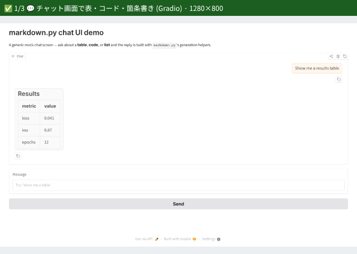

# markdown

<p align="center">
  
</p>

[Icon](https://myon-bioinformatics.github.io/markdown/icon.png) · [Favicon](https://myon-bioinformatics.github.io/markdown/favicon.png)

A function-focused Python Markdown utility that runs on the standard library only.

📘 [利用ガイド / Usage guide](https://myon-bioinformatics.github.io/markdown/) (GitHub Pages)

## GitHub About（推奨）

> Stdlib-only Markdown helpers for Python: read/write, section extraction, and HTML↔Markdown utilities for URLs and images. Reusable functions with a small stdio CLI; verified by tests.

## Purpose

This library grows the `markdown.py` module, used earlier in projects such as Ironmate, so it can be published on pip under the same file name.

- **Standard library first** — avoid adding runtime dependencies, and extend features within that limit. Standalone users copy the file from GitHub; the copied `markdown.py` keeps working on its own.
- **Function-focused** — an optional `md-market` CLI delegates to the same library helpers. Behavior is verified by tests. The processing in `demos/*.py` is checked directly as plain function calls that need no browser; optional Streamlit / Gradio front-end checks are also possible.
- **Planned API direction** — beyond the existing read / write / section extraction, expand the HTML↔Markdown helpers (URLs, image files, and so on).
- **ascii_artist** — ASCII art utilities have moved to [`myon-bioinformatics/ascii_artist`](https://github.com/myon-bioinformatics/ascii_artist) and are not bundled here.

<details>
<summary>🇯🇵 日本語</summary>

ironmate などで使っていた `markdown.py` を、同じファイル名のまま pip で配布できるように育てるライブラリです。

- **標準ライブラリ前提**: 実行時の依存関係は増やさず、その範囲で機能を充実させます。スタンドアロンで使う場合は GitHub からファイルをコピーします。コピーした `markdown.py` 単体のまま動きます。
- **関数提供に特化**: `md-market` CLI は同じ関数を呼ぶ最小の入口です。動作はテストで確認します。`demos/*.py` の処理も、ブラウザを使わない通常の関数呼び出しとして直接検証します。任意で Streamlit や Gradio の画面確認もできます。
- **API の方向性**: 既存の read / write / セクション抽出に加えて、HTML と Markdown の相互変換ヘルパ（URL や画像ファイルなど）を広げていきます。
- **ascii_artist**: ASCII アート関連のユーティリティは [`myon-bioinformatics/ascii_artist`](https://github.com/myon-bioinformatics/ascii_artist) に分離しており、このリポジトリには含めていません。
</details>

## Layout

| Path | Role |
| --- | --- |
| `markdown.py` | **Canonical vendoring artifact** — stdlib-only single module. Standalone users copy the file from GitHub; consumers may also pin it as `vendor/markdown.py` |
| `tests/` | pytest = correctness |
| `fixtures/` | Famous-README-inspired offline snippets + YAML/JSON/TOML + `benchmark/` (real, sourced Markdown) |
| `demos/gradio_app.py` | Optional: paste/upload → instant analysis. `analyze()` has zero UI deps — call it directly |
| `demos/streamlit_app.py` | Optional: sectioned headings/links/images/HTML/code view. `build_view()` has zero UI deps — call it directly |
| `demos/chat_ui_demo.py` | Optional: generic mock chat screen — assistant replies built with `markdown.py`'s generation helpers, rendered by Gradio's `Chatbot` |
| `docs/antipatterns.md` | Stable library/integration anti-pattern IDs plus concrete CI/Docker/Playwright incidents, root causes, fixes, and regression lessons |
| `scripts/real_world_pages_report.py` | Local, best-effort report (not published; the README benchmark keeps only the counts): original vs. `html_to_markdown()`→`markdown_to_html()` round-trip, screenshotted via Playwright's own CLI, for every real HTML fixture in `fixtures/provenance.yaml`. The page shell, stylesheet and table come from PySaiyanWeBoo's `web_ui` (dev group, pinned to a commit) |

## Optional Gradio-only nano environment

The stdlib-only `markdown.py` core needs no environment reduction. For the real
Gradio frontend, see the [opt-in, pinned nano-environment recipe](docs/nano-environment.md).
It keeps Gradio and its native dependencies, omits the separate Streamlit/browser
closure, and leaves all existing dependency groups, tests and CI unchanged.

## Quick use

```python
import markdown as md_market

md_market.save_markdown("# Hello\n", "out.md")
sections = md_market.extract_sections(open("out.md", encoding="utf-8").read())
slides = md_market.split_slides("# One\n\nbody\n\n---\n\n# Two\n")  # pages at ---: title, body, content
inv = md_market.inventory(open("README.md", encoding="utf-8").read())
print(md_market.html_image_to_markdown(''))
print(md_market.make_link("Docs", "https://example.com"))

# GitHub alert (also flavor="qiita" / "zenn" / "obsidian" / "gitlab")
print(md_market.alert("NOTE", "Useful information that users should know"))

# build Markdown from scratch
report = md_market.section(
    "Summary",
    [
        md_market.key_value_table({"mode": "train", "epochs": 10}),
        md_market.bullet_list(["loss down", "iou up"]),
        md_market.blockquote("keep the contract small"),
    ],
)
print(report)

# library-side HTML + CSS (no separate .css asset required)
html = "<style>" + md_market.default_stylesheet() + "</style>\n" + md_market.markdown_to_html(report)
print(html)

# thin Markdown ↔ Kramdown IAL (headings / paragraphs only)
print(md_market.with_attributes(md_market.heading("Intro"), id="intro", classes="hero"))
print(md_market.markdown_to_kramdown("# Title {#intro .hero}"))
```


## Distribution and vendoring names

This repository intentionally separates the **vendored filename** from the planned **PyPI/import name**.

- Source/vendoring artifact: `markdown.py`
- Typical vendored destination: `vendor/markdown.py`
- Planned PyPI distribution name: `md-market`
- uv git distribution name: `md-market` (no runtime dependencies)
- Python module/file name: `markdown.py`

`md-market` is only the distribution name. The actual module remains the single-file `markdown.py`, preserving the project's stdlib-only, copy-one-file vendoring model.

Standalone users copy the file from GitHub. That copy stays standard-library only and keeps working on its own. Environments that install through uv use the repository URL below, which installs the same module and adds no runtime dependencies:

```sh
uv pip install git+https://github.com/myon-bioinformatics/markdown
```

Ironmate is a vendored consumer: changes are developed here first, then a reviewed snapshot of `markdown.py` is refreshed in Ironmate.


## Lightweight HTML DOM helpers

`HtmlNode` is a small, stdlib-only normalized tree for conversion work. It is
**not** a browser DOM and does not claim HTML5 tree-construction fidelity.

- `parse_html_dom(html)` builds a root/element/text tree with lowercase tags.
- `dom_to_html(node)` serializes only the supported safe tag subset.
- `dom_to_markdown(node)` reuses the existing conservative HTML→Markdown
  contract; `<details><summary>` is preserved as the repository's
  `:::details` form.
- `markdown_to_dom(markdown)` converts through the existing
  `markdown_to_html()` subset and then parses the sanitized tree.

The boundary is intentionally conservative: `script` / `style` subtrees,
event attributes such as `onclick`, inline `style=`, and unsafe absolute URL
schemes are dropped. `http`, `https`, `mailto`, and relative URLs remain
allowed; unambiguous `host:port` references such as `example.com:8080/path`
are normalized to network-path form (`//example.com:8080/path`) so they are
not mistaken for custom schemes. This is a dangerous-scheme rejection policy,
not an absolute-URL-only allowlist. The same URL policy is shared by DOM
serialization and the existing Markdown link/image/autolink HTML helpers.
Rejected links degrade to plain text
and rejected images to alt text rather than leaving empty `href` / `src`
attributes or `[text]()` intermediates. Unknown tags degrade to transparent
containers so safe text and supported descendants remain available. Existing
`html_to_markdown()` and `markdown_to_html()` are not rewritten around the DOM
layer in this first contract-focused step.


### Code-block newline round trips

HTML-to-Markdown conversion reuses a code block's terminal LF as the fence
separator. It preserves multiple terminal/internal blank lines instead of
collapsing them as paragraph spacing. Regression checks compare restored code
text to the original, including indentation and trailing spaces; stable
Markdown alone does not establish a lossless round trip.

Fenced Markdown remains line-oriented: HTML code with **no terminal LF** is
rendered with one terminal LF by the existing Markdown renderer. This known
normalization is explicitly tested, and is not counted as exact preservation.
This change does not promise arbitrary HTML/CSS reversibility.

Code inside `<details>` now preserves its pre/code structure and literal blank
lines through the repository's `:::details` form. For example,
`<details><summary>Code</summary><pre><code>a\n\n\n\n</code></pre></details>`
(where `\n` denotes LF) retains all four linefeeds. The details reader uses the
shared fence scanner and code renderer; a literal `:::` inside code does not
close the container. Unclosed code fences consume through EOF like standalone
code. Other nested block types retain the existing paragraph-only contract.
No metadata for restoring absent terminal linefeeds is added.

## Converter integration scaffold

The HTML→Markdown compatibility engine is intentionally split from its public
entry point. `html_to_markdown()` remains the stable compatibility wrapper,
while `_html_to_markdown_impl()` is the internal parser engine shared by the
lightweight DOM path. This prevents a future recursion loop if the public HTML
entry point is ever evaluated for a DOM-first implementation.

PR #37 treats DOM/legacy parity as an **observability contract**, not as a
requirement that every existing path already be identical. Representative
supported cases are required to stay equal, while only **observed final
Markdown differences** are recorded as known gaps. Intermediate DOM/HTML shape
changes are not classified as parity failures when both paths still produce
the same Markdown. For example, `caption` / `colgroup` / `col` may be
transparent in the lightweight DOM, but the legacy engine already ignores
those structures in supported table output, so they are not a known final
Markdown gap by themselves.

PR #38 closes the previously observed URL-safety gap between the legacy and
DOM HTML→Markdown paths. Both now reuse the shared URL policy: unsafe absolute
schemes degrade to visible link text / image alt text, while safe URLs remain
links/images. The shared host:port normalization also applies consistently, so
an unambiguous value such as `example.com:8080/path` becomes the network-path
reference `//example.com:8080/path`.

PR #39 normalizes the empty-output boundary between the legacy and DOM
HTML→Markdown paths. Empty or fully-suppressed input now returns `""` rather
than a lone newline. Non-empty Markdown output keeps the existing contract of
exactly one trailing newline. This deliberately treats empty-output
normalization separately from broader whitespace or nested-list behavior.

PR #40 adds a deterministic legacy-vs-DOM parity report for the next
architecture decision. The report runs both HTML→Markdown paths over synthetic
edge cases plus every vendored real-world HTML fixture under
`fixtures/benchmark/`, records equality, output lengths, SHA-256 hashes, and
short previews for mismatches, and emits a decision hint. Synthetic coverage
explicitly includes blockquotes, inline/preformatted code, and alt-only image
fallbacks in addition to lists/tables/details/URL cases.

The report also records `real_world_case_count` separately. At present the
repository has only one vendored real-world HTML page, so even a hypothetical
zero-mismatch run is **not** enough to recommend DOM-first; the hint remains
`expand_real_world_corpus_before_dom_first` until the real-world corpus is less
thin. The hint is evidence, not an automatic switch: DOM-first remains a review
decision based on observed mismatches, compatibility, and complexity.

The current real-world HTML corpus is intentionally small: today it contains
one vendored page (`tohoho_web_home.html`). That is enough to catch at least
one real-page whitespace divergence, but not enough to treat a zero-mismatch
result as broad production evidence. Synthetic coverage therefore also pins
blockquotes, inline/preformatted code, image alt handling, lists, tables,
details, URL safety, Unicode, empty output, and host:port behavior. Expanding
the vendored real-HTML corpus remains follow-up work before any public
DOM-first cutover.

PR #41 closes the synthetic `details` mismatch surfaced by that report.
Legacy `html_to_markdown()` now preserves `<details><summary>` using the
same `:::details Summary ... :::` Markdown contract as `dom_to_markdown()`.
The implementation remains inside the legacy HTML parser, so the compatibility
engine does not gain a dependency on the DOM layer.

```bash
python scripts/converter_parity_report.py --out converter_parity.json
```

PR #42 broadens that observability into a converter-contract audit. It records
HTML→Markdown parity plus Markdown→HTML→Markdown and Markdown→DOM→Markdown
stability across core constructs (lists, tables, details, tasks, footnotes,
attributes, malformed input, Unicode, URL safety, and empty input) and vendored
real-world HTML. Audit schema v2 keeps every exact-round-trip mismatch in
`raw_divergent_case_ids`, but separates explicitly documented irreversible
contracts into `expected_lossy_case_ids` from still-unexplained
`divergent_case_ids`. Markdown footnotes are the first expected-lossy case:
`[^id]` refs/definitions are intentionally lowered to ordinary HTML anchors
and a footnotes section, and `html_to_markdown()` does not reconstruct the
original footnote syntax. Remaining divergence is observational, not
automatically treated as a bug.

```bash
python scripts/converter_contract_audit.py --out converter_contract_audit.json
```

URL scheme safety for conversion paths is centralized in
`_sanitize_url_scheme()`: new HTML→Markdown or Markdown→HTML URL-consuming
conversion code must reuse that helper rather than introduce an independent
scheme check. Extraction helpers such as `extract_links()` /
`extract_images()` only report source content, and builders such as
`make_link()` / `make_image()` continue to treat the caller-supplied URL as
caller responsibility; changing those contracts is a separate design decision.

DOM-specific preprocessing such as `details` handling stays in
`dom_to_markdown()`; the internal HTML engine remains DOM-agnostic. Nested-list
behavior, whitespace normalization, safe-tag expansion, and any eventual
DOM-first switch are intentionally deferred to later PRs after this scaffold
has made their effects measurable.

## Context helpers

The stdlib-only context helpers added in PR #12 are deterministic preparation
utilities, not a CommonMark parser or an LLM summarizer:

- extract_section selects one ATX heading and its nested children.
- strip_prose_keep_structure keeps headings, lists, blockquotes, thematic breaks,
  and fenced code while dropping ordinary prose lines.
- minify_markdown removes optional HTML comments and collapses excessive blank
  lines without converting Markdown.
- safe_truncate enforces a character limit and closes an open code fence when
  the limit leaves enough room.

Conversation-history compression and broader HTML conversion remain separate
future design topics. See docs/context-helpers.md for the exact contracts.

## Dialects, system formats, directory trees, LLM output

All stdlib-only; `SUPPORTED` lists them machine-readably and each docstring
states its contract.

- Wiki/chat dialects (both directions): `markdown_to_slack_mrkdwn` /
  `slack_mrkdwn_to_markdown`, `markdown_to_org` / `org_to_markdown`,
  `markdown_to_mediawiki` / `mediawiki_to_markdown`, `markdown_to_jira` /
  `jira_to_markdown`, and `markdown_to_chat_messages` /
  `chat_messages_to_markdown` (roles in `CHAT_ROLES`).
- System formats: `calendar_to_markdown`, `platform_to_markdown`,
  `email_to_markdown` / `markdown_to_email` (header injection is rejected), and
  the one-way `markdown_to_man` (troff requests cannot be injected from text or
  `.TH` fields).
- Directory trees: `markdown_to_directory_tree` / `directory_tree_to_markdown`,
  `tree_text_to_markdown` / `markdown_to_tree_text`, `directory_to_markdown`,
  and `scaffold_from_markdown`. Listings accept any name the tree format can
  represent; `scaffold_from_markdown` only creates names valid on POSIX and
  Windows alike, and never outside the root or over an existing file.
- LLM output: `split_reasoning`, `compact_llm_output`, `llm_output_digest`,
  `extract_identifiers` (see the `llm io` section marker in `markdown.py`).

## 🎞️ Browser evidence



Recorded 2026-11-24 at Markdown commit `583589b` with BrowserTestKit's `evidence_gif.py`. The same GIF is the 🎞 tab of the [usage guide](https://myon-bioinformatics.github.io/markdown/).

🗓️ 2026-11-24 · 🧭 Chromium 153 · 🐧 Linux · receipt [`docs/evidence/browser.json`](docs/evidence/browser.json)

| 🧪 Shot | ✅ |
| --- | :-: |
| 💬 chat UI demo (Gradio, 1280×800): table → code → list | ✅ |
| 📱 chat UI demo (392×848) | ✅ |
| 🩺 repository diagnostics | ✅ |

🚫 Not in the GIF: the real-world page (vendored for parser benchmarks only, not redistribution). Firefox / WebKit not installed.

🔁 Re-record (start `GRADIO_SERVER_PORT=7861 python demos/chat_ui_demo.py` first):

```sh
python scripts/markdown_repository_diagnostics.py /tmp/site
uv run --project ../BrowserTestKit --group pages --group browser python ../BrowserTestKit/tools/evidence_gif.py docs/evidence/browser.gif --serve /tmp/site --plan docs/evidence/browser.json --force
```

## Benchmark: how far does this get on real Markdown?

`tests/test_benchmarks.py` runs real, published Markdown — not just this repo's own
README — through `markdown.py` and records, reproducibly, what works and what doesn't. The goal
isn't "pass everything" (this is explicitly not a full CommonMark/GFM engine — see Capability
stance below); it's knowing exactly where the edges are, and pinning that down so a real change
is a deliberate decision, not a silent regression.

Sources (full provenance — commit SHA, license, exact excerpted line ranges — in
[`fixtures/provenance.yaml`](fixtures/provenance.yaml)):

- **CommonMark spec** (`fixtures/benchmark/commonmark_examples.yaml`) — 13 of the spec's own 655
  numbered examples (spec version 0.31.2), covering headings, emphasis, nested emphasis, escaping,
  blockquotes, nested lists, fenced/inline code, horizontal rules, links, and two emphasis edge cases
- **GitHub Docs** (`fixtures/benchmark/github_docs_markdown.md`) — real excerpts from
  [github/docs](https://github.com/github/docs)'s own Markdown-writing documentation, covering
  headings, links, images, fenced code (including a fence nested inside a fence), nested lists,
  tables, task lists, autolinks, alerts, footnotes, and inline HTML
- **nodejs/node's `CONTRIBUTING.md`** (`fixtures/benchmark/contributing_example.md`) — a real OSS
  contributing guide, close to verbatim
- **axios/axios's `CHANGELOG.md`** (`fixtures/benchmark/changelog_example.md`) — the real first 400
  (of 1416) lines, for long-input stability with many headings/links/lists/version strings
- **とほほのWWW入門** (`fixtures/benchmark/tohoho_web_home.html`) — the real, live top page (not a git
  repo, so provenance is `fetched_at` + sha256 instead of a commit SHA): 1 `<h1>`, 24 `<h2>`, 263
  `<a href>`, `<header>`/`<aside>`/`<main>`/`<footer>` semantic wrappers, a `<form>`, and inline
  `<script>` ad blocks — a real, dense page for `html_to_markdown()` (the *other* direction), not
  just the small synthetic snippet `test_benchmarks.py` used to rely on alone

Results, CommonMark spec examples:

| Construct | Classification |
| --- | --- |
| ATX headings, emphasis (basic), fenced code, inline code, horizontal rule, links | PASS |
| nested emphasis (`**foo *bar* baz**`) | DEGRADED — the inner `*bar*` parses, the outer `**` doesn't |
| nested lists | PASS — simple indentation-based nested ul/ol structure is preserved |
| blockquotes | DEGRADED — consecutive `>` lines become `<blockquote><p>…</p></blockquote>`; inner ATX headings/lists/tables stay paragraph text; blank `>` lines split paragraphs |
| backslash escaping | FAIL — not implemented; `\*` stays literal instead of suppressing emphasis |
| emphasis edge cases (asymmetric delimiter runs, whitespace-adjacent delimiters) | FAIL |

Results, GitHub-flavored constructs found inside the real GitHub Docs excerpt:

| Construct | Classification |
| --- | --- |
| headings, links, images, fenced code (incl. fence-in-fence), inline code | PASS |
| nested lists | PASS — simple indentation-based nested ul/ol structure is preserved |
| tables | PASS — simple GFM pipe tables (header + `\| --- \|` delimiter) render as `<table>/<thead>/<th>/<tbody>/<td>`; cell text is escaped and reuses the inline renderer. Alignment colons are accepted, not emitted as attributes. Pipe rows without a delimiter stay paragraphs. |
| strikethrough (`~~text~~`) | PASS — renders as `<del>text</del>`; unmatched `~~` stays literal |
| task lists | PASS — `- [ ]` / `- [x]` / `- [X]` (also `*` / `+`) become `<li>` with a disabled checkbox; mixed with ordinary bullets in one `<ul>`. This fixture's Task lists section only shows the syntax in inline code, so it stays literal there. `1. [ ]` is not a task. |
| footnotes | PASS — live `[^id]` plus `[^id]:` definitions become superscript links and a trailing `<section class="footnotes">`. This fixture's Footnotes section only shows the syntax in a fenced example, so it stays code there. Undefined refs stay literal; duplicate ids: first definition wins. |
| autolinks | DEGRADED — `<https://…>` / `<http://…>` become `<a href>`; bare URLs stay literal. Arbitrary `<tag>` (including `<script>`) is escaped, not linked. |
| alerts (`> [!NOTE]`) | PASS — GitHub uppercase `[!NOTE]`/`[!TIP]`/`[!IMPORTANT]`/`[!WARNING]`/`[!CAUTION]` (no same-line title) render as `<aside class="markdown-alert">`. Qiita `:::note`, Zenn `:::message`, and Obsidian callouts are also supported. Ordinary `>` quotes render as `<blockquote>`; alerts still win when the opener is `[!TYPE]`. |
| inline HTML | UNSUPPORTED — escaped, not passed through |

```bash
uv run pytest tests/test_benchmarks.py -v
```

All three run in the default `pytest` — no extra dependency installs. `test_benchmarks.py`
is a separate, exploratory HTML → Markdown → HTML round trip; it's deliberately not part of the
PASS/DEGRADED/UNSUPPORTED/FAIL grading above.

Results, `html_to_markdown()` on the real とほほのWWW入門 page: every one of its 25 headings and 263
links survives as a real Markdown construct (`test_tohoho_headings_and_links_survive_html_to_markdown`),
and the round trip back to HTML keeps all of them too. `<header>`/`<aside>`/`<main>`/`<footer>` aren't
in `_HTMLToMarkdownParser`'s handled-tag list, so they contribute no Markdown syntax of their own, but
the real text they wrap still survives (same "unsupported tag, text not data" fallback as unhandled wrapper tags; simple ``<table>`` is now converted to GFM pipes).
`<script>` content is suppressed, not leaked, same as `<style>`.

Construct counts on [とほほのWWW入門](https://www.tohoho-web.com/) (the vendored copy fetched 2026-09-19, `html_to_markdown()` → `markdown_to_html()`):

| 🏷️ Tag | 📄 Original HTML | 🔁 Round trip |
| --- | ---: | ---: |
| `<h1>` | 1 | 1 |
| `<h2>` | 24 | 24 |
| `<a>` | 263 | 263 |
| `` | 2 | 2 |

Only these counts are shown here. The page's HTML and screenshots are not published (all rights reserved by its author; vendored for parser benchmarks only). `python scripts/real_world_pages_report.py --out /tmp/site` rebuilds the side-by-side report locally.

## Capability stance

This is **not** a full CommonMark/GFM engine (see `SUPPORTED` / `UNSUPPORTED` in `markdown.py`, and
the benchmark above for what that looks like on real documents).
It shines at I/O, inventory, URL/image/HTML helpers, conservative conversions, and generating
Markdown from scratch (`heading`, `bold`/`italic`/`strikethrough`, `blockquote`, `alert`, `horizontal_rule`,
`bullet_list`/`numbered_list`/`task_item`/`task_list`, `inline_code`/`code_block`/`json_block`, `table`/`key_value_table`,
`md_table`/`md_kv` (`*args`-friendly, no list/dict pre-building needed), `status_line`,
`section`/`wrap_section`, `details`, `footnote`/`footnote_ref`) — all of which you can reason about.

`alert()` emits GitHub `> [!NOTE]` by default (`kind` is case-insensitive, emitted uppercase).
Pass `flavor="qiita"` for `:::note info|warn|alert`, `flavor="zenn"` for `:::message` /
`:::message alert`, `flavor="obsidian"` for lowercase callouts with optional `title=` / `fold=`,
or `flavor="gitlab"` for GitLab's lowercase five-kind form (optional `title=`). Unknown GitHub /
Qiita / Zenn / GitLab kinds raise `ValueError`. `markdown_to_html()` renders those blocks to a
shared `<aside class="markdown-alert" data-alert-flavor="…">` shape. Embed
`<style>{md_market.default_stylesheet()}</style>` (or `md_market.alert_stylesheet()`) next to
`markdown_to_html(...)` output — compact stdlib CSS, no separate `.css` file and
no external URLs. Ordinary `>` blockquotes render as `<blockquote>` (multi-line;
blank `>` lines split paragraphs). Simple GFM pipe tables from `table()` /
`key_value_table()` / `md_table()` round-trip through `markdown_to_html()` into
`<table>`. `~~text~~` becomes `<del>`. GFM task lists (`task_item()` /
`task_list()`, or hand-written `- [ ]` / `- [x]`) render as disabled
checkboxes. Angle-bracket `<https://…>` / `<http://…>` autolinks become
`<a href>` (bare URLs stay literal). `details(summary, body)` emits
Zenn-style `:::details` which `markdown_to_html()` turns into
`<details><summary>` (raw HTML `<details>` in Markdown stays escaped by default).
🔓 For trusted input, `markdown_to_html(text, raw_html=True)` passes CommonMark HTML blocks through
(`<div>` / `<p>` / `<details>` … up to a blank line, `<script>` / `<style>` / `<pre>` up to the
closing tag), renders the inside of a `markdown="1"` tag as Markdown, and keeps `&lt;`-style
entities outside code. `attr_list=True` reads a Kramdown block IAL (`{: #id .class key="v"}`)
on the line after a paragraph, heading, table or list, and a trailing `{#id}` on a heading. Both are off by default; they cover
the parts of Python-Markdown's `md_in_html` / `attr_list` that pages built from Python use.
`[^id]` plus `[^id]:` definitions become superscript footnote links and
a `.footnotes` section. `html_to_markdown()` maps simple `<table>` trees
back to GFM pipes, `<del>` to `~~…~~`, and checkbox `<li><input>` to
`- [ ]` / `- [x]`. Heading / paragraph `id` / `class` become a trailing
Pandoc-style `{#id .class}`; `markdown_to_kramdown()` turns that into a
Kramdown block IAL (`{: #id .class key="value"}`), and
`kramdown_to_markdown()` strips known IAL back to plain Markdown
(attributes dropped). `ial()` / `with_attributes()` write those IAL
lines. Wikipedia infoboxes, Math, mermaid, Liquid `` / `{{ }}`,
YAML front matter, Jekyll includes / tags / baseurl, and full Kramdown
(extensions, math, TOC macros, span IAL) remain out of scope, as does
full CommonMark/GFM.

`code_block()`'s fence length is adaptive: plain content still gets a triple-backtick fence, but
content that itself contains a run of backticks (e.g. Markdown-about-Markdown, like a fenced example
inside a doc — see the GitHub Docs benchmark fixture above for a real one) gets a longer fence, just
enough to stay unambiguous, matching what CommonMark itself requires. Pass `fence_char="~"` for a
tilde fence instead. See `tests/test_syntax.py`.

## License

MIT


## Web UI contract v1

`markdown_to_web_ui_v1()` wraps the existing conservative Markdown-to-HTML
subset in the stable semantic surface defined by
[`myon-bioinformatics/PySaiyanWeBoo/contract/v1`](https://github.com/myon-bioinformatics/PySaiyanWeBoo/tree/4f43617465a92c912efcd441208e1789b3508d32/contract/v1) (pinned reference: `4f436174`).

The helper emits semantic HTML only:

- `body[data-ui-theme]`
- `ui-page`
- optional `ui-title`
- `ui-panel`

It does **not** fetch, vendor, or embed PySaiyanWeBoo CSS. Consumers should pin the
PySaiyanWeBoo revision they load separately. Theme names are case-sensitive.

Future breaking contract support should use a separate versioned emitter such as
`markdown_to_web_ui_v2()` rather than silently changing v1 output semantics.

This keeps `markdown.py` single-file and standard-library-only.


## Repository diagnostics

GitHub Pages publishes the shared repository metadata contract as
`repository-diagnostics.json`, a one-record `repository-diagnostics.jsonl`,
and `repository-diagnostics.html`. The metadata contract is pinned from
Ironmate, anonymous public GitHub observations are pinned from
mcp-toolcall-lab, and the HTML renderer is the PySaiyanWeBoo commit pinned by
the parent's `reusable-pages-static.yml` (the same one that renders the guide). Network failures remain `unverified`; no GitHub token is used
by the public resolver.

The metadata contract and generator are vendored together from Ironmate commit
`0aee64da2f8d0119a3ef9b955e5c3818f28aaf92`. Refresh both files and their
provenance records from the same pinned commit. The generator reads the
checked-out Git HEAD for commit identity; Actions refs supply branch context.
The Pages workflow checks out the PR head before generating diagnostics.

## Shared screenshot evidence

`scripts/real_world_pages_report.py` and `scripts/check_report_screenshots.py` stay as a local, best-effort lane:
every HTML entry in `fixtures/provenance.yaml` gets `original.png` and `roundtrip.png`, checked with BrowserTestKit's
shared stdlib `check_png.py` and current-run receipts (`tests/test_report_screenshot_evidence.py`, which runs when
`BROWSER_TEST_KIT` points at a checkout). CI no longer captures or publishes them, because the real-world page is
vendored for parser benchmarks only, not redistribution. See the
[shared guide](https://github.com/myon-bioinformatics/BrowserTestKit/blob/6a2e32a4bbe49be5268e6b30040d665a89eecf66/docs/screenshot-evidence.md).

Public source placement and automatic Python CI updates: [vendor automation](docs/vendor-automation.md).

## Runtime and development Python policy

The standard-library source runtime requires Python 3.11 or newer, matching the
installable project's Python floor. Python 3.9 and 3.10 are no longer supported.
The separate `runtime-compatibility` CI lane executes those checks with
`python -S -m unittest`, without installing pytest or any third-party package.
The uv project requires Python >=3.11 and has no runtime dependencies.
pytest is a dev dependency with a lower bound only, and every pytest lane
runs through `uv run pytest` against the committed lock. Standalone users
copy the file from GitHub; that copy does not need this uv project:

```sh
uv sync --locked --group dev --python 3.11
uv run pytest
uv sync --locked --group dev --group frontend --python 3.11  # Gradio/Streamlit/Playwright tests
python -S -m unittest discover -s tests -p test_runtime_compatibility.py -v
```

`pyproject.toml` is the only development dependency definition (no
requirements files). The unittest lane does not
install that uv environment, so the Python 3.11-3.14 runtime checks stay
independent of the development dependencies.

`[tool.uv] override-dependencies` lifts transitive pins that upstream frontends
still cap below current PyPI releases (remove each line when the cap is gone):

- `pillow>=13.0.0` — Gradio / Streamlit declare `pillow<13` (Pillow 13.0.0+ security fixes).
- `safehttpx>=0.2.0` — Gradio declares `safehttpx<0.2.0`.
- `tomlkit>=0.15.2` — Gradio declares `tomlkit<0.15.0`.

Playwright still caps `pyee<15`; on Python 3.11 the lock stays at pyee 13.0.1 because
newer pyee releases require Python 3.12+. No override is applied for pyee.

CI pins astral-sh/setup-uv to full commit 68559e99cc807c1eb7e9238fd43a15bba460eec2
(v10.3.3) and installs uv version latest. Every other action, including those
from the actions organization, is also pinned to a full commit SHA with its
release tag as a comment. Setup actions using Node 24 require runner
2.327.1 or newer (GitHub-hosted runners are used).

## Select converter evaluation cases

```sh
python -S scripts/converter_contract_audit.py --case 'html:*' --exclude '*unsafe*' --list
python -S scripts/converter_parity_report.py --case 'html:table' --out table-parity.json
```

The two evaluation scripts share `--case` (repeatable OR), `--exclude`, and
`--list`. Patterns match a case key or its id, case-sensitively. Keys use
`html:`, `markdown:` or `structured_cycle:` prefixes; an unqualified id may
select multiple kinds. Selection precedes fixture reading and conversion.
Listing creates no report and cannot be combined with `--out`; invalid rules
or empty selections return 2. With no rules, the existing full report remains
byte-for-byte equivalent. Subsets report their explicit selection scope/counts;
the parity decision hint is `selected_cases_only`, never a whole-corpus claim.
A selected unavailable structured cycle stays explicitly unavailable.

Validation: 25 focused tests passed; both entry points list cases with `python -S`.

## Focused test discovery

See [standard-library discovery commands](docs/unittest-discovery.md) for
validated `python -S -m unittest discover` recipes, filename/name filtering,
and the boundary with the full pytest suite.


## uv command

```sh
uv tool install .
md-market --help
printf '# Hello\n' | md-market to-html
```

`md-market` supports `inventory`, `to-html`, `to-markdown`, and `toc`. Input is
UTF-8 from stdin or an optional filename; output goes to stdout.
Use `uvx --from 'git+https://github.com/myon-bioinformatics/markdown.git@main' md-market --help`
for one-time use, or `uv add /absolute/path/to/markdown` for Python imports.
Replace main with a reviewed full SHA for reproducibility. No frontend dependencies are installed.
